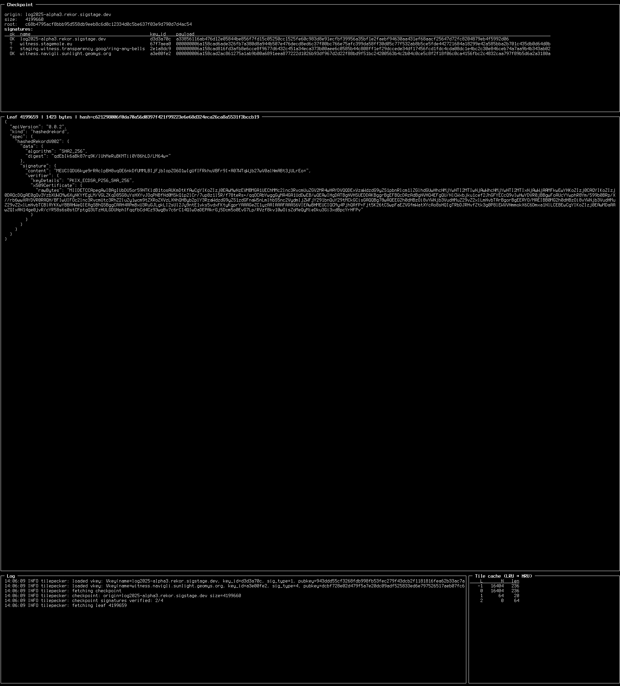

# tilepecker



Another take on [woodpecker](https://github.com/transparency-dev/incubator/tree/main/woodpecker-web), based on [tlog-scales](https://github.com/florolf/tlog-scales).

Can parse different leaf entry formats and verify log/cosignatures.

**Caveat emptor**: This UI is 100% vibe coded garbage, but the stuff that is actually load-bearing (tlog-scales) has been written by hand by myself.

Usage, e.g.:

```
$ tilepecker https://log2025-alpha3.rekor.sigstage.dev --vkey 'log2025-alpha3.rekor.sigstage.dev+d3d3a70c+AZQ93VXPMmj9uZj7U/7CefQ9yy8RgYFv6mKzOseipjqp' --vkey 'witness.navigli.sunlight.geomys.org+a3e00fe2+BNy/co4C1Hn1p+INwJrfUlgz7W55dSZReusH/GhUhJ/G' --format json
```

`--vkey @FILE` reads vkeys from `FILE`, one per line (blank lines and lines starting with `#` are ignored).

### Policies

Instead of (or in addition to) `--vkey`, a trust policy in the
sigsum-style policy format (with either sigsum hex keys or C2SP vkeys) can be supplied
with `--policy FILE`. Its log and witness keys are used for signature
verification, and the checkpoint pane shows whether the checkpoint is signed by
a policy log and whether the witness quorum is satisfied. If the policy names
exactly one log with a URL, the location argument can be omitted.

```
$ cat keyserver.policy
log keyserver.geomys.org+16b31509+ARLJ+pmTj78HzTeBj04V+LVfB+GFAQyrg54CRIju7Nn8 https://keyserver.geomys.org/tlog
witness navigli witness.navigli.sunlight.geomys.org+a3e00fe2+BNy/co4C1Hn1p+INwJrfUlgz7W55dSZReusH/GhUhJ/G
quorum navigli
$ tilepecker --policy keyserver.policy
```

When a policy is given, use the location argument to select a log by its full URL
or a unique, case-sensitive substring:

```
$ tilepecker --policy logs.policy keyserver.geomys.org
```

The selector must match exactly one log URL in the policy. Without `--policy`,
the location is used directly as a local path or URL.
